<p align="center">
  <a href="https://axsomette.github.io/"></a>
</p>

<p align="center">
  <a href="https://axsomette.github.io/"></a>
  &nbsp;
  <a href="https://axsomette.github.io/app.html"></a>
</p>

<p align="center">
  
  
  
  
</p>

**MonBudget** est un gestionnaire de budget personnel qui tient dans votre navigateur. Vous ajoutez une
dépense en quelques secondes, vous fixez vos limites, vous simulez le mois prochain. Aucun compte,
aucun serveur : vos lignes restent sur votre appareil, et un fichier JSON suffit pour les sauvegarder
ou les retrouver ailleurs.

Je l'ai construit parce que je ne trouvais rien qui soit à la fois simple, privé et vraiment utile.
Je m'en sers tous les mois.

## Ce qu'elle fait

<p align="center">
  
  
  
  
</p>

- **Tableau de bord** : le bilan de la période (reste à vivre, revenus, dépenses), un mois précis ou tout
  l'historique, l'historique filtrable et la répartition des dépenses.
- **Catégories et limites** : vos propres catégories et sous-catégories, une limite par catégorie, et
  au besoin une limite différente pour un mois donné.
- **Charges fixes** : loyer et abonnements marqués « fixes » ; sur un mois encore vide, l'app propose de
  reprendre ceux des autres mois en un clic.
- **Simulateur** : vous visez un plafond pour le mois prochain, il répartit l'effort sur les dépenses
  qui peuvent baisser (les charges fixes sont mises de côté).
- **Comparer deux mois** : barres, radar et courbe, avec ce qui explique la différence.
- **Objectifs d'épargne** : chaque versement devient une ligne de l'historique et ajuste le reste à vivre.
- **Score de santé** et **conseil du mois** : un score sur quatre critères (épargne, budgets, charges
  fixes, objectifs) et des analyses qui arrivent toutes seules.
- **Thème clair ou sombre**, au choix.

<p align="center">
  
</p>

## En images

<p align="center">
  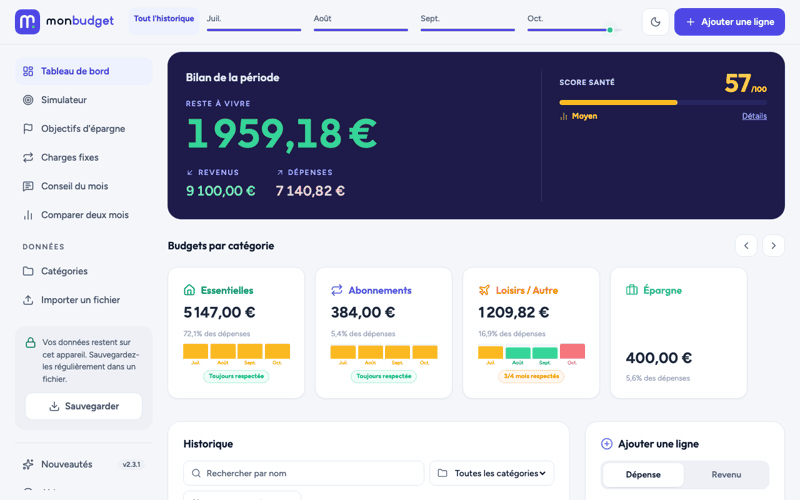
</p>

<p align="center">
  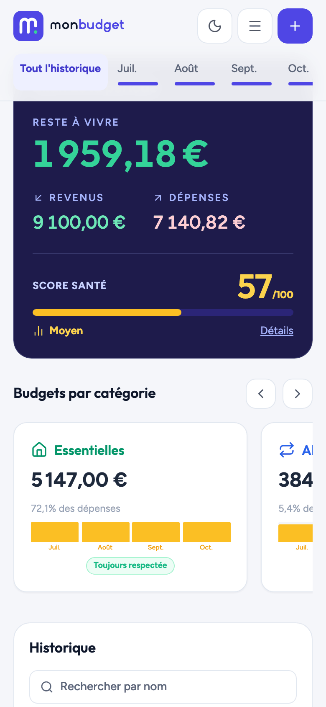
  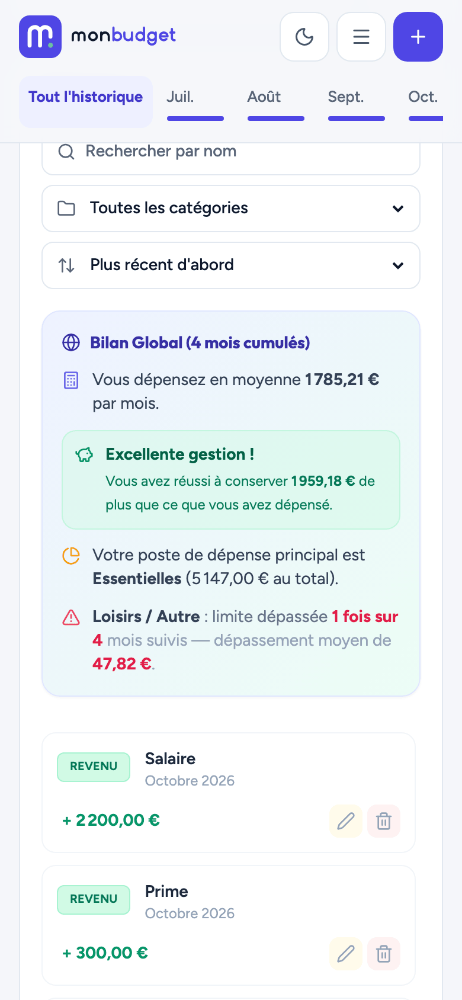
  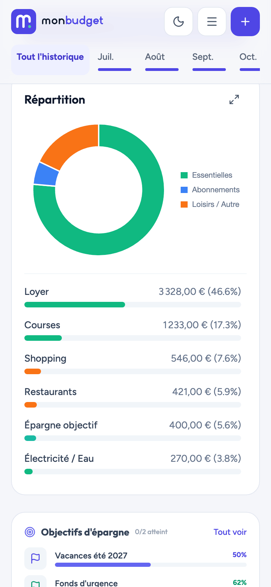
</p>

<details>
<summary>Les écrans en grand</summary>
<br>

| Tableau de bord | Thème sombre |
|---|---|
| 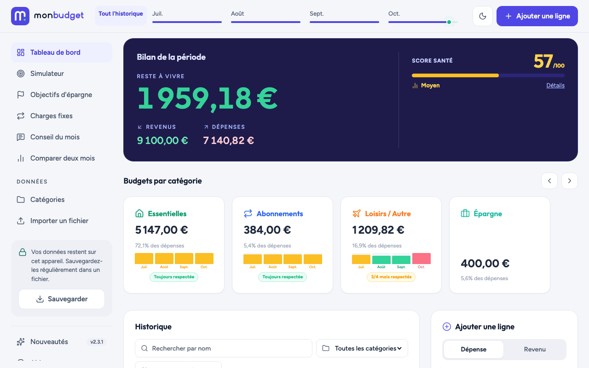 | 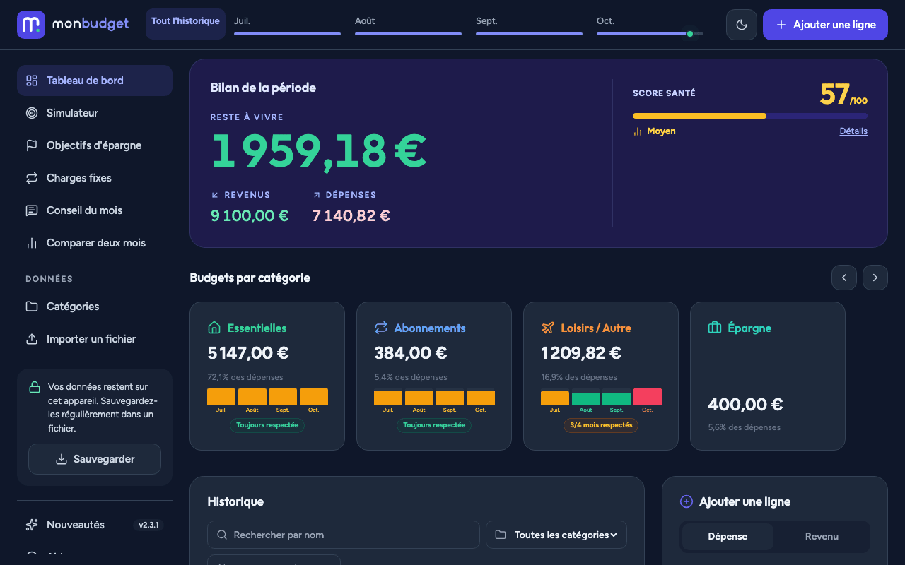 |
| **Simulateur** | **Comparateur** |
| 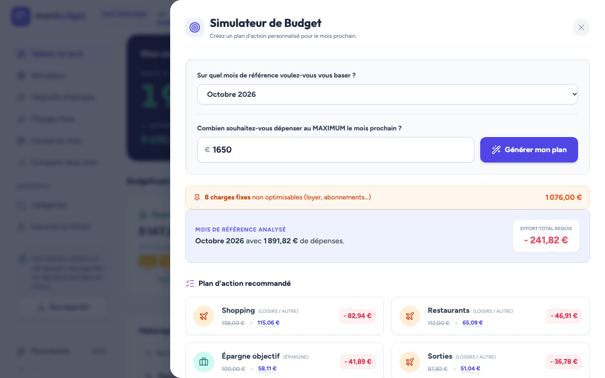 | 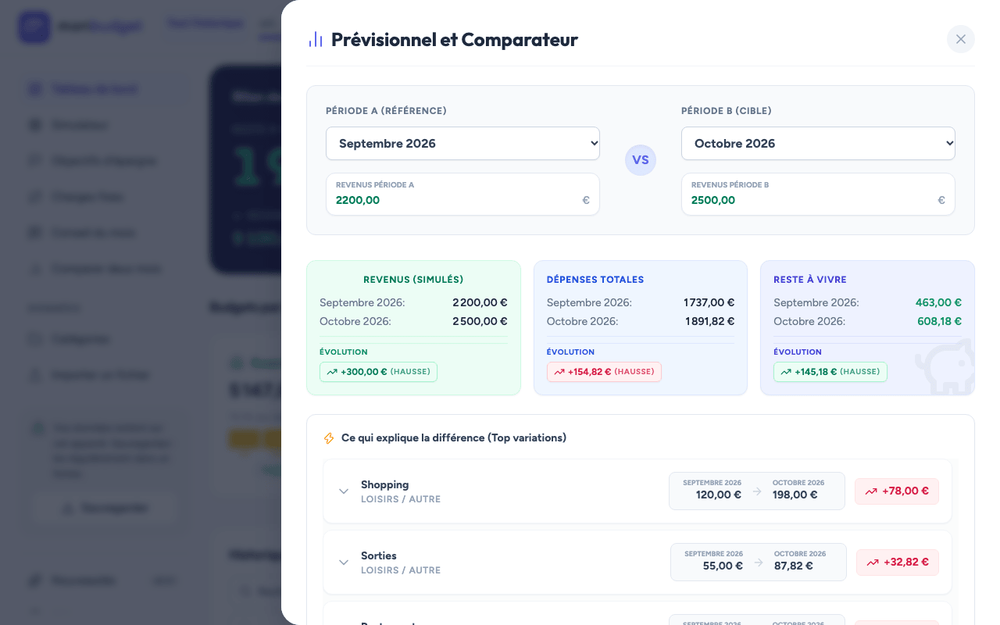 |

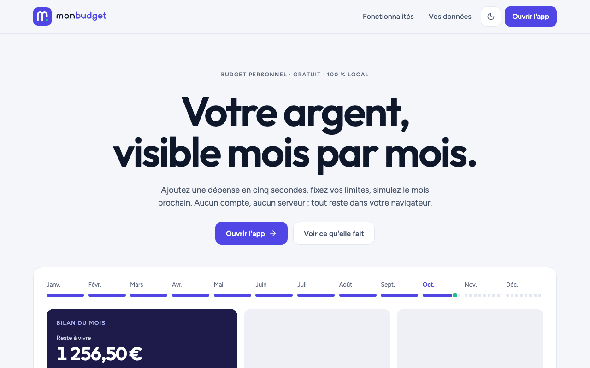

</details>

> Les captures viennent du site en ligne, remplies avec des données d'exemple inventées.

## L'installer comme une app

MonBudget a un manifeste d'application : il s'ouvre dans sa propre fenêtre, avec son icône.

- **iPhone et iPad** : dans Safari, bouton Partager › **Sur l'écran d'accueil**.
- **Android** : dans Chrome, menu ⋮ › **Ajouter à l'écran d'accueil**.
- **Ordinateur** : dans Chrome ou Edge, l'icône d'installation dans la barre d'adresse, si elle apparaît,
  sinon un simple favori.

Il faut une connexion pour l'ouvrir (Tailwind, Chart.js et les icônes viennent d'un CDN). Vos données,
elles, ne quittent jamais l'appareil.

## Vos données

Tout est enregistré dans le stockage local du navigateur (`localStorage`) : entrées, catégories, limites
et objectifs. Rien n'est envoyé nulle part, il n'y a ni compte, ni publicité, ni mesure d'audience.

- **Sauvegarder** télécharge un fichier `budget_global_AAAA-MM-JJ.json`.
- **Importer un fichier** le recharge, sur le même appareil ou sur un autre.

Pensez à sauvegarder de temps en temps : vider les données du navigateur efface aussi votre budget.

## Sous le capot

<p>
  
  
  
  
  
  
</p>

Du HTML, du CSS et du JavaScript sans framework ni étape de compilation : ce qui est dans le dépôt est
exactement ce qui est servi sur GitHub Pages.

| Fichier | Rôle |
|---|---|
| `index.html` | Page d'accueil |
| `app.html`, `app.js`, `ui.js` | L'application |
| `style.css` | Les couleurs, les polices (Outfit et Figtree) et les animations |
| `manifest.json` | Le manifeste d'app (nom, couleurs, icônes) |
| `logo/` | Le logo et son [guide d'usage](logo/README.md) |

Pour la lancer en local, n'importe quel serveur statique suffit :

```bash
python3 -m http.server 8000
# puis http://localhost:8000/
```

## Le logo

Le m de « Mon » se lit comme deux mois : le premier jambage descend jusqu'en bas (mois bouclé), le
second s'arrête en route (mois en cours), et le point vert marque où vous en êtes. Indigo `#4f46e5`,
vert `#10b981`, encre `#0f172a`. Tout est dans [`logo/README.md`](logo/README.md), y compris l'animation
de chargement que reprend la bannière ci-dessus.

## Licence

© 2024-2026 Lucas Jimenez Boulot. Tous droits réservés : le code est visible pour un usage personnel,
non commercial et pédagogique, mais pas réutilisable sans autorisation. Voir [`LICENSE`](LICENSE) et
[`NOTICE`](NOTICE), qui liste aussi les bibliothèques tierces (Tailwind CSS et Chart.js sous licence MIT,
Lucide sous licence ISC).

<p align="center"><sub>Conçu et développé par <a href="https://axsomette.github.io/lucas-jimenez-boulot/">Lucas Jimenez Boulot</a>, alias Axsom.</sub></p>
